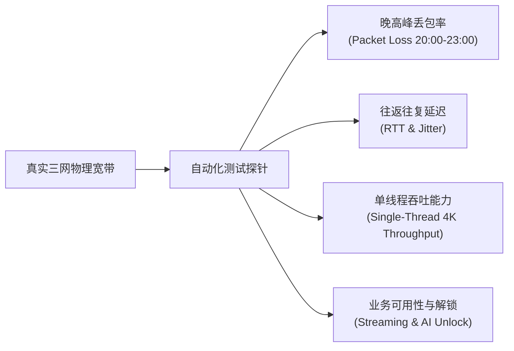

<Breadcrumb :items="[{ title: '首页', link: '/' }, { title: '评测方法论' }]" />

# 评测基准与网络性能测试方法论 (Testing Methodology)

最后更新：2026年首季

在纷繁复杂的网络服务市场中，“主观好用”、“瞬时单次测速图”往往极具误导性。为了彻底杜绝“特供优化节点”、“开局一张图，内容全靠编”的行业乱象，**机场推荐网络监测实验室**建立了一套高度工程化、可复现、严禁人为干预的标准化评测体系。

本文档详尽公开本实验室的物理测试环境、核心指标采集模型、防作弊评测规范及流媒体/AI 解锁判定标准，供全网技术人员监督与复现。

---

## 一、物理硬件与网络探针环境

与许多仅依靠海外 VPS 节点互相 Ping 测的虚拟评估站不同，本实验室所有核心数据均采集自**中国大陆真实终端物理宽带**：

### 1. 三大骨干网实体宽带测试床
- **中国电信（China Telecom）**：上海/广州核心骨干网出口，千兆下行（1000Mbps）/ 百兆上行（100Mbps），原生动态公网 IPv4/IPv6 双栈；
- **中国联通（China Unicom）**：北京/山东核心骨干网出口，千兆下行（1000Mbps）/ 百兆上行（100Mbps），AS4837 骨干网接入；
- **中国移动（China Mobile）**：广东/浙江核心骨干网出口，千兆下行（1000Mbps）/ 百兆上行（100Mbps），CMI 国际出口直连。

### 2. 探针硬件配置
- **测试网关**：工控软路由（Intel Core i7-1265U / 32GB DDR4 / 双 Intel i226-V 2.5GbE 网卡），运行定制 OpenWrt 稳定内核；
- **压测终端**：物理工作站搭载 Linux (Ubuntu 24.04 LTS)，禁用一切本地系统缓存与代理加速插件，直连软路由 LAN 口，杜绝 Wi-Fi 无线信号衰减干扰。

---

## 二、四大核心性能评估指标与计算模型

实验室绝不依赖单一的“跑满测速”截图，而是通过自动化脚本每隔 15 分钟发起一次连续采样，重点采集以下四大核心维度：

### 1. 晚高峰丢包率 (Peak-Hour Packet Loss)
- **采集时段**：每日 **20:00 - 23:00**（全网公网互联压力最大、国际出口最拥堵的黄金时段）。
- **测试标准**：对目标节点入口连续发送 1,000 个 64 字节 ICMP/TCP-SYN 探测包，统计丢包比例。
- **评级标准**：
  - **S 级（卓越专线）**：丢包率 $\le 0.1\%$，全天无任何感知断流；
  - **A 级（优质专线/优化直连）**：丢包率 $\le 1.0\%$，网页秒开，4K 播放无缓冲；
  - **B 级（及格中转）**：丢包率 $1.0\% - 3.0\%$，偶发极微小卡顿；
  - **C 级（严重超售）**：丢包率 $> 5.0\%$，频繁超时报错，判定为不推荐。

### 2. 首包延迟与抖动 (RTT & Jitter)
- **测量方法**：通过 TCPing 工具对入口端点执行 100 次握手往返测试，剔除最高 5% 与最低 5% 的异常噪点后取加权平均值。
- **抖动计算**：$\text{Jitter} = \frac{1}{N-1}\sum_{i=1}^{N-1} |RTT_{i+1} - RTT_i|$。标准优质 IEPL 专线抖动通常控制在 **2ms 以内**。

### 3. 单线程真实吞吐量 (Single-Thread Throughput)
- 许多劣质服务商依靠 Speedtest 多线程并发（16-32 线程）堆砌出几百兆的虚假测速图，但用户在实际观看 YouTube、Twitch 或传输大文件时，绝大多数依赖**单线程 TCP 连接**。
- **测试方式**：从海外独立机房（Google Cloud、AWS 边缘存储）通过 HTTP/3 与 TLS 1.3 直接拉取 1GB 镜像文件，记录单线程稳定传输速率。单线程速率大于 **45Mbps** 即可稳定流畅播放 4K 60fps HDR 视频。

### 4. 链路连通可用性 (Availability SLA)
- 7×24 小时不间断监控节点握手成功率，计算月度综合 SLA 连通率。
- **SLA 评判公式**：$\text{SLA} = \frac{\text{成功探测次数}}{\text{总探测次数}} \times 100\%$。

---

## 三、流媒体与原生 AI 解锁判定标准

现代出海用户不仅需要“能连上”，更需要“能看、能用”。实验室维护着独立的解锁检测探针，每日动态检测：

<table>
  <thead>
    <tr>
      <th>平台类型</th>
      <th>测试目标</th>
      <th>判定为“完全通过”的硬性标准</th>
    </tr>
  </thead>
  <tbody>
    <tr>
      <td><strong>流媒体平台</strong></td>
      <td>Netflix / Disney+ / YouTube Premium</td>
      <td>
        • <strong>Netflix</strong>：必须能播放非自制剧（如各地区独占版权影片），非仅限自制剧（Originals Only）； 
        • <strong>Disney+</strong>：无任何“Error 83”或黑屏拦截，能够以 4K 超高清格式播放； 
        • <strong>YouTube</strong>：正常免除广告，Premium 权益生效，后台播放正常。
      </td>
    </tr>
    <tr>
      <td><strong>前沿 AI 服务</strong></td>
      <td>OpenAI (ChatGPT) / Claude / Google Gemini</td>
      <td>
        • <strong>ChatGPT</strong>：Web 端与 App 端登录无阻，GPT-4o / Canvas 交互无“Access Denied”报错； 
        • <strong>Claude</strong>：Anthropic 官方风控极严，必须使用原生住宅/企业高信任度 IP，连续对话无封号或 IP 封锁拦截； 
        • <strong>Gemini</strong>：正常加载 Workspace 协作与高级多模态模型能力。
      </td>
    </tr>
  </tbody>
</table>

---

## 四、超售套路与黑天鹅防作弊排查 SOP

为了防范服务商的“跑路盘”、“暗扣倍率”套路，实验室严格执行以下反作弊审核：

1. **扣费倍率双向核算 (Audit Multipliers)**：
   - 在客户端通过流量计费监控软件记录发送与接收的物理字节数；
   - 对比服务商用户后台扣除的额度，核实是否存在“标称 1.0x，实扣 3.0x”的暗偷流量行为。
2. **骨干路由 MTR 穿透审查 (BGP / Transit Routing)**：
   - 使用多跳 MTR 跟踪工具探测节点真实路由走向。
   - 彻底排查所谓“纯物理专线”是否中途跳向普通公网 163 骨干，揭露“伪专线”挂羊头卖狗肉的虚假宣传。
3. **域名与基础设施生命周期监测**：
   - 监控服务商官网域名的 WHOIS 变更、SSL 证书颁发历史与 CDN 节点变动；
   - 一旦发现运营团队频繁更换充值收款商户号、官网连续数日无法访问，即刻触发风控告警。

---

## 五、公开、透明与同行复核

本方法论受同行评审原则（Peer Review）指导。任何网络技术工程师如果对我们的测速结果或结论存在疑问，欢迎提供符合本方法论采集标准的 MTR 日志与 Wireshark 抓包数据，我们将在第一时间展开复核，详见 [联系我们与勘误反馈](/contact/)。
